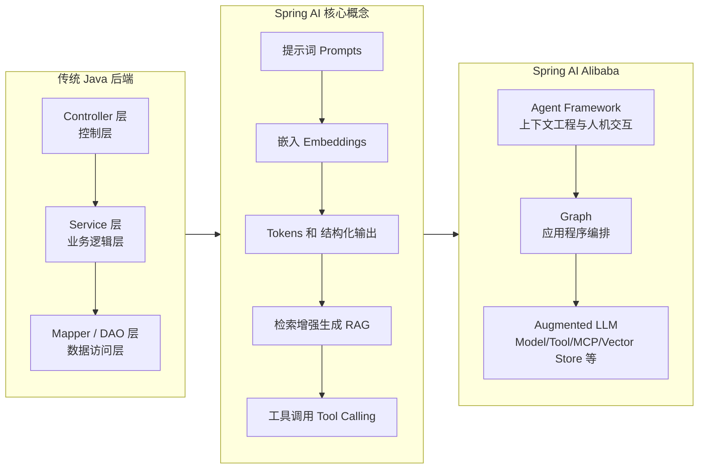
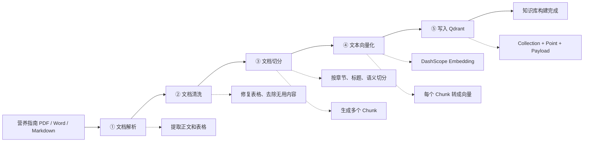

# SpringAIAlibaba-智能体标题简单设计思路（java后端项目丝滑配置智能体！）


## 目录

- [前言](#前言)
- [一、认识 Spring AI Alibaba](#一认识-spring-ai-alibaba)
  - [一、简介](#一简介)
  - [二、和传统 Java 后端和 Spring AI 框架的关系](#二和传统java-后端和-spring-ai框架的关系)
  - [三、与其他智能体框架的区别](#三与其他智能体框架的区别)
- [二、环境准备和简单的智能体入门](#二环境准备和简单的智能体入门)
  - [一、环境准备和 Maven 依赖导入](#一环境准备和meaven依赖导入)
  - [二、创建 ChatModel 和 ChatClient](#二创建chatmodel和chatclient)
  - [二、对调用案例的具体解释](#二对调用案例的具体解释)
  - [三、简单实战](#三简单实战)
- [三、知识库 RAG 检索功能](#三知识库rag检索功能)
  - [一、向量知识库准备工作](#一向量知识库准备工作)
  - [2. 使用知识库之前，要对知识库进行切分](#2-使用知识库之前要对知识库进行切分)
- [总结](#总结)

# 前言


>## 大家好，我是一名大学生，目前在学习传统的Spring框架以及智能体开发。
>## 接下来将发表第一篇文章来介绍如何在spring项目中使用Spring AI Alibaba来快速搭建一个职责清晰智能体。
>## 本文章更适合学过传统java后端开发的程序猿。

# 一、认识Spring AI Alibaba

## 一、简介

### 1.Spring AI Alibaba 是阿里巴巴**基于 Spring AI** 生态打造的 AI 应用开发框架，主要用于在 **Java / Spring Boot 项目**中开发**大模型应用、AI 智能体和多智能体**系统。

### 2.官方资源
**Spring AI官方文档**中文链接：[简介 :: Spring AI 参考手册 - Spring 框架](https://docs.springframework.org.cn/spring-ai/reference/index.html)   
### Spring AI--**github**仓库链接：[spring-projects/spring-ai: An Application Framework for AI Engineering](https://github.com/spring-projects/spring-ai)


### **Spring AI Alibaba官方文档**链接：[概览 | Spring AI Alibaba](https://java2ai.com/docs/overview/)	
### Spring AI Alibaba--**github仓库**链接：[alibaba/spring-ai-alibaba](https://github.com/alibaba/spring-ai-alibaba)

### 二、和**传统Java 后端**和**Spring AI框架**的关系： 


上面这张图就是本文要讲的三层关系：**传统 Java 后端**提供工程基础，**Spring AI** 提供大模型接入的抽象能力，**Spring AI Alibaba** 在此之上补齐阿里云生态适配与多智能体编排，最终落地为智能体应用。
## 三、与其他智能体框架的区别

### Java AI 应用开发框架的选择

| 能力点                  | Spring AI | Spring AI Alibaba     | LangChain4j   |
| :---------------------- | :-------- | :-------------------- | :------------ |
| 统一 LLM 调用接口       | ✅         | ✅（兼容 + 增强）      | ✅             |
| RAG（检索增强生成）     | ✅         | ✅（集成阿里云向量库） | ✅（功能更全） |
| 基础 Agent / 工具调用   | ✅         | ✅                     | ✅（核心能力） |
| 企业级工作流 / Graph    | ❌ ✅       | ❌                     |               |
| 多 Agent 协作           | ❌         | ✅                     | ❌             |
| Human-in-the-Loop       | ❌         | ✅                     | ❌             |
| Spring 生态原生集成     | ✅（核心） | ✅（继承 + 增强）      | ❌（需手动）   |
| 阿里云生态深度适配      | ❌         | ✅                     | ❌             |
| 可观测性（监控 / 日志） | ✅（基础） | ✅（企业级）           | ❌             |

**适用场景**
* **Spring AI**：适合需要「跨云 / 跨模型、基于 Spring 生态、无厂商绑定」的通用 AI 应用开发（如简单的 LLM 对话、基础 RAG 应用）。
* **Spring AI Alibaba**：适合「基于阿里云生态、需要企业级管控、复杂智能体 / 工作流」的生产级场景（如企业智能客服、智能办公助手、业务流程自动化 Agent）。
* **LangChain4j**：适合「轻量化 LLM 应用、无需 Spring 生态、快速验证原型」的场景（如小工具、Demo 级 RAG 应用），或非 Spring 技术栈的 Java 项目。

**注：此表格源自马士云课程**

据以上表格可以轻松的出一个结论：Spring AI Alibaba在这几个Java AI 应用开发框架中是**功能最强大**的！

# 二、环境准备和简单的智能体入门

## 一、环境准备和Meaven依赖导入
## 1.环境准备

- JDK 17+
- Maven 3.8+
- 选择你的 LLM 提供商并获取 API-KEY（如阿里云百炼的 DashScope）

[阿里百炼平台地址](https://bailian.console.aliyun.com/)
## 2.依赖导入

这里使用的项目结构是传统的 common-pojo-server 结构。
### 2.1在父依赖安装环境

```xml
<!-- Spring AI Alibaba -->
<dependency>
     <groupId>com.alibaba.cloud.ai</groupId>
     <artifactId>spring-ai-alibaba-bom</artifactId>
     <version>${spring-ai-alibaba.version}</version>
     <type>pom</type>
     <scope>import</scope>
 </dependency>

 <!-- ==================== Spring AI ==================== -->
 <dependency>
     <groupId>org.springframework.ai</groupId>
     <artifactId>spring-ai-bom</artifactId>
     <version>${spring-ai.version}</version>
     <type>pom</type>
     <scope>import</scope>
 </dependency>
```
### 2.2在server层引入依赖

```xml
<!-- Spring AI Alibaba -->
<dependency>
     <groupId>com.alibaba.cloud.ai</groupId>
     <artifactId>spring-ai-alibaba-starter-dashscope</artifactId>
     <version>${spring-ai-dashscope.version}</version>
 </dependency>

<! -- framework -->
 <dependency>
     <groupId>org.springframework.ai</groupId>
     <artifactId>spring-ai-starter-model-openai</artifactId>
 </dependency>

 <!-- Spring AI Alibaba Graph-->
 <dependency>
     <groupId>com.alibaba.cloud.ai</groupId>
     <artifactId>spring-ai-alibaba-starter-graph-observation</artifactId>
 </dependency>

 <dependency>
     <groupId>com.alibaba.cloud.ai</groupId>
     <artifactId>spring-ai-alibaba-agent-framework</artifactId>
 </dependency>

```

## 二、创建ChatModel和ChatClient
### 1.yaml文件配置


```yaml
llm:
  dashscope:
    api-key: ${YourAPIKEY} ##配置好自己的APIKEY
    # 选择自己喜欢的模型，我这里以qwen3.8-flash和deepseek-v4.1-flash-1017为例
    qwen-model: qwen3.8-flash
    deepseek-model: deepseek-v4.1-flash-1017
```
### 2.在common层进行属性注入

```java
@Data
@Component
@ConfigurationProperties(prefix = "llm.dashscope")
public class LLMProperties {

    private String apiKey;
    
    private String qwenModel;
    
    private String deepseekModel;
}
```
### 3.进行ChatModel和ChatClient配置
#### 3.1以阿里云为例，找到模型使用开放文档 [阿里云模型广场](https://bailian.console.aliyun.com/cn-beijing/model/market)
找到自己适合的模型，它会提供使用说明：


### 3.2在Server层实现具体配置
```java
@Configuration
public class LLMConfig {

    //千文模型
    @Autowired
    private LLMProperties llmProperties;


    @Bean
    public ChatModel qwenChatModel() {
        OpenAiApi api = OpenAiApi.builder()
                .baseUrl("https://dashscope.aliyuncs.com/compatible-mode")
                .apiKey(llmProperties.getApiKey())
                .build();

        OpenAiChatOptions options = OpenAiChatOptions.builder()
                .model(llmProperties.getQwenModel())   // qwen3.8-flash
                .build();

        return OpenAiChatModel.builder()
                .openAiApi(api)
                .defaultOptions(options)
                .build();
    }

    @Bean
    public ChatClient qwenChatClient(
            @Qualifier("qwenChatModel") ChatModel qwenChatModel) {

        return ChatClient.builder(qwenChatModel).build();
    }

    //Deepseek模型
    @Bean
    public ChatModel deepseekChatModel() {

        OpenAiApi api = OpenAiApi.builder()
                .baseUrl("https://dashscope.aliyuncs.com/compatible-mode")
                .apiKey(llmProperties.getApiKey())
                .build();

        OpenAiChatOptions options = OpenAiChatOptions.builder()
                .model(llmProperties.getDeepseekModel())// deepseek
                .build();

        return OpenAiChatModel.builder()
                .openAiApi(api)
                .defaultOptions(options)
                .build();
    }

    @Bean
    public ChatClient deepseekChatClient(
            @Qualifier("deepseekChatModel") ChatModel deepseekChatModel) {

        return ChatClient.builder(deepseekChatModel).build();
    }

}
```
### 3.3构造案例进行测试

```java
@RestController
public class ChatModelController {

    private final ChatModel qwenChatModel;

    // 注入 ChatModel
    public ChatModelController(@Qualifier("qwenChatModel") ChatModel qwenChatModel) {
        this.qwenChatModel = qwenChatModel;
        this.deepseekChatModel = deepseekChatModel;
    }
		// 注入 ChatClient
    public AIController(@Qualifier("qwenChatClient") ChatClient qwenChatClient) {
        this.qwenChatClient = qwenChatClient;
    }

    /**
     * 使用 ChatModel 调用通义千问模型
     * 访问示例：http://localhost:8080/model/qwen?message=给我讲一下java的stream流用法
     */
    @GetMapping("/model/qwen")
    public String askQwen(@RequestParam(value = "message", defaultValue = "你好") String message) {
        // 1. 手动封装系统消息（System Message）
        SystemMessage systemMessage = new SystemMessage("你是一个精通 Java 和 Spring Boot 的资深架构师。");
        
        // 2. 手动封装用户消息（User Message）
        UserMessage userMessage = new UserMessage(message);

        // 3. 组装成 Prompt 对象（把消息列表传进去）
        Prompt prompt = new Prompt(List.of(systemMessage, userMessage));

        // 4. 调用底层 ChatModel 发起请求，获取响应对象
        ChatResponse response = qwenChatModel.call(prompt);

        // 5. 从复杂的响应结构中层层剥离出文本内容
        return response.getResult().getOutput().getContent();
    }

		/**
     *  使用 ChatClient调用通义千问模型
     * 访问示例：http://localhost:8080/ai/qwen?message=给我讲一下java的stream流用法
     */
    @GetMapping("/ai/qwen")
    public String askQwen(@RequestParam(value = "message", defaultValue = "你好") String message) {
        return qwenChatClient.prompt("你是一个精通 Java 和 Spring Boot 的资深架构师。")
                .user(message)
                .call()
                .content(); // 获取大模型返回的文本内容
    }
}
```
## 二、对调用案例的具体解释
### 1.ChatModel和ChatClient的区别
| 对比角度 | ChatModel (底层模型接口)                                     | ChatClient (高层客户端接口)                                 |
| :------- | :----------------------------------------------------------- | :---------------------------------------------------------- |
| 输入     | 需传入结构化的 `Prompt`（包含 Message 列表、Options 配置）   | 支持更简便的链式输入（如直接传 `String`、绑定系统提示词等） |
| 输出     | 返回标准的 `ChatResponse`（包含 Generation、Token 消耗、元数据 Metadata） | 支持流式输出（`flux()`）、结构化输出及高级包装结果          |

$$\text{ChatClient}\longrightarrow \text{ChatModel} \longrightarrow \text{底层大模型 API (如 DashScope / OpenAI)}$$
### 2.解释案例的具体对象

```java
qwenChatClient.prompt("你是一个精通 Java 和 Spring Boot 的资深架构师。")
        .user(message)
        .call()
        .content();
```
#### 2.1 prompt：系统提示词，告诉大模型它在本次对话中的角色、身份或行为准则。
#### 2.2 user ：用户消息
#### 2.3 call：远程调用
#### 2.4 content：直接提取出大模型生成的文本内容（String）
## 三、简单实战
### 现在我给大家一段多模态模型识别食品的代码

```java
		// 把大模型输出的内容转换成 Java 对象的工具
        BeanOutputConverter<FoodRecognize> converter = new BeanOutputConverter<>(FoodRecognize.class);
		//获取输出格式要求
        String format = converter.getFormat();
        //构建用户请求
        UserMessage userMessage = UserMessage.builder()
                .text("""
                    请识别这张菜品图片。
                    
                    你可以调用食材查询工具，
                    查询数据库中已经存在的食材名称。
                    
                    识别食材时，只保留能够识别且存在于数据库中的食材。
                    如果没有符合条件的食材，将 ingredientData 设置为 null。
                    
                    请返回菜品名称、分类、描述、食材及重量、价格。
                    必须按照指定的 JSON 格式返回结果。
                  """ + format)
                  //以下是沿用spring ai的用法
                .media(new Media(
                				//媒体类型
                        MimeTypeUtils.parseMimeType(contentType),
                        //媒体数据转化为二进制数据
                        new ByteArrayResource(imageData)
                ))
                .build();

        // 调用 Qwen 多模态模型
        FoodRecognize re = qwenChatClient
                .prompt()
                .messages(userMessage)
                .tools(foodQueryTools)//提供封装好的工具
                .call()
                .entity(FoodRecognize.class);//指定返回数据类型
```
### 1.至于图片数据如何传给AI，spring ai alibaba 是 沿用了spring ai 的方法，感兴趣的同学可以看官方文档
[Spring AI 多模态（Multimodality）官方文档](https://docs.springframework.org.cn/spring-ai/reference/api/multimodality.html)
### 2. tools(foodQueryTools)这里是封装好了foodQuery工具给智能体调用

```java
@Component
public class FoodQueryTools {

    @Autowired
    private FoodMapper foodMapper;

    @Autowired
    private IngredientMapper ingredientMapper;

    @Tool(description = "查询所有食材信息" )
    public List<Ingredient> queryAllIngredient() {
        return ingredientMapper.selectAll();
    }

    @Tool(description = "根据名称查询食品信息" )
    public FoodVO queryFoodByName(String name){
        return foodMapper.selectByName(name).get(0);
    }


    @Tool(description = "查询所有食品信息" )
    public List<Food> queryAllFood() {
        return foodMapper.selectAll();
    }

    @Tool(description = "根据各营养摄入范围进行条件查询,其中分页控制参数和基础检索参数不用填，其他参数根据需求填写即可,不用每一项都填写" )
    public List<FoodVO> queryFoodByNutritionRange(FoodPageDTO foodPageDTO){
        return foodMapper.pageQuery(foodPageDTO);
    }

}
```
#### 2.1  @Tool(description = "" )是工具描述，相当于给工具起名字，方便智能体理解
#### 2.2 智能体调用方法，会自动读取返回的数据的实体类内容
#### 2.3 entity(FoodRecognize.class)指定了智能体返回的数据格式，这样可以很方便的对返回的数据后续进行处理

# 三、知识库rag检索功能
## 一、向量知识库准备工作
### 1. 先为大家介绍三种常用也是我接触过的向量知识库
| 对比维度      | Qdrant                                             | Milvus                                           | Elasticsearch                                        |
| :------------ | :------------------------------------------------- | :----------------------------------------------- | :--------------------------------------------------- |
| 核心优势      | 专注向量检索，性能优秀，元数据过滤能力强，部署简单 | 支持海量向量检索，分布式扩展能力强，索引算法丰富 | 全文检索能力强，支持关键词与向量混合搜索，生态成熟   |
| 局限性 / 短板 | 复杂全文搜索能力较弱，不适合替代关系型数据库       | 架构复杂，部署和运维成本较高，中小项目可能过重   | 向量检索资源开销较大，向量索引调优相对复杂           |
| 典型适用场景  | AI 知识库、RAG、语义搜索、智能客服                 | 海量图片检索、大规模推荐系统、企业级 AI 检索     | 电商搜索、日志检索、企业文档搜索、全文与语义混合检索 |

**总结：**

- **Qdrant**：专注向量检索，适合 RAG 项目。
- **Milvus**：专注大规模向量检索，适合海量数据。
- **Elasticsearch**：擅长全文搜索，适合复杂搜索业务。


>## Qdrant部署简单、容易上手，接下来我将以Qdrant为例来教大家怎么用知识库
## 2. 使用知识库之前，要对知识库进行切分
### 2.1 知识库构建流程

知识库的构建是一个从「原始文档」到「可检索向量」的完整流水线，整体分为五个阶段：



各阶段职责说明：

| 阶段          | 核心动作                                   | 产出                    |
| :------------ | :----------------------------------------- | :---------------------- |
| ① 文档解析    | 读取 PDF / Word / Markdown，提取正文与表格 | 结构化文本              |
| ② 文档清洗    | 修复表格结构、去除页眉页脚等无用内容       | 干净文本                |
| ③ 文档切分    | 按章节、标题、语义切分                     | 多个 Chunk              |
| ④ 文本向量化  | 调用 DashScope Embedding 模型              | 每个 Chunk 对应一个向量 |
| ⑤ 写入 Qdrant | 创建 Collection，写入 Point 与 Payload     | 可检索的知识库          |


>## 实际专业切分其实非常复杂，这里我们将以一个简单切分为例来介绍
### 2.2 准备引入的依赖
在Server层引入

```xml
 <!-- Qdrant 向量存储 -->
 <dependency>
     <groupId>org.springframework.ai</groupId>
     <artifactId>spring-ai-qdrant-store</artifactId>
 </dependency>
```
### 2.3 在本地docker直接下载Qdrant
打开电脑cmd命令直接拉去Qdrant镜像
```bash
docker pull qdrant/qdrant
```
接着创建并启动容器

```bash
docker run -d --name smart-qdrant -p 633`在这里插入代码片`3:6333 -p 6334:6334 -v qdrant_storage:/qdrant/storage qdrant/qdrant
```
容器启动成功后，在浏览器中访问 `http://localhost:6333/dashboard` 即可进入 Qdrant 的 Web 管理界面（Dashboard）。在左侧导航栏点击 **Collections**，就能看到当前实例下的所有集合（Collection），后续创建的知识库集合也会在这里展示。

按需创建，如果不知道就如图填写创建
### 2.4 在 application.yml 中配置

```yaml
spring:
  ai:
    vectorstore:
      qdrant:
        host: localhost #Qdrant 所在地址，我们先默认本地
        port: 6334 #Qdrant 的 gRPC 端口
        collection-name: my-collection #集合名称
        initialize-schema: true #是否允许自动初始化集合
        use-tls: false #是否使用 TLS
```
然后完成向量知识库配置

```java
@Configuration
public class VectorStoreConfig {

    /** Qdrant gRPC 地址 */
    @Value("${qdrant.host:localhost}")
    private String host;

    /** Qdrant gRPC 端口（注意不是 REST 的 6333） */
    @Value("${qdrant.port:6334}")
    private int port;

    /** 是否启用 TLS，本地 docker 默认关闭 */
    @Value("${qdrant.tls:false}")
    private boolean tls;

    /** 集合名称 */
    @Value("${qdrant.collection:集合名称}")
    private String collectionName;

    /**
     * 创建 Qdrant 客户端
     */
    @Bean
    public QdrantClient qdrantClient() {
        //连接Qdrant 服务地址
        QdrantGrpcClient.Builder grpcClientBuilder = QdrantGrpcClient.newBuilder(host, port, tls);
        return new QdrantClient(grpcClientBuilder.build());
    }

    /**
     * 主集合
     */
    @Bean
    @Primary
    public VectorStore vectorStore(QdrantClient qdrantClient, EmbeddingModel embeddingModel) {

        return QdrantVectorStore.builder(qdrantClient, embeddingModel)
                .collectionName(collectionName) // 集合名称
                .initializeSchema(false)
                .build();
    }
}
```

### 2.5 然后我们对知识库进行简单切分
在 resources 下面创建一个文件夹放我们的知识库md文件
例如：我们文件 nutrition.md 长这样

```
# 学生营养知识

学生每天需要摄入充足的蛋白质。
蛋白质是人体生长发育的重要营养素。

学生应该保证每天摄入适量的蔬菜和水果。
蔬菜和水果可以提供维生素、矿物质和膳食纤维。

牛奶和奶制品是钙的重要来源。
适量摄入奶类有助于满足身体对钙的需求。

# 合理膳食建议

学生应该保持食物多样化。
日常饮食应该包含谷薯类、蔬菜水果、动物性食物和奶豆坚果。

学生应该减少高油、高盐和高糖食品的摄入。
```
然后可以直接通过空行进行切分

```java
public class KnowledgeImportService {

    private final VectorStore vectorStore;

    public KnowledgeImportService(VectorStore vectorStore) {
        this.vectorStore = vectorStore;
    }
    
    public void importKnowledge() throws Exception {

        // 1. 读取 Markdown 文件
        ClassPathResource resource = new ClassPathResource("knowledge/nutrition.md");

        String content;

        try (InputStream inputStream = resource.getInputStream()) {
            content = new String(inputStream.readAllBytes(),StandardCharsets.UTF_8);
        }

        // 2. 按照空行切分
        String[] chunks = content.split("(?:\\r?\\n)[\\t ]*(?:\\r?\\n)+");

        // 3. 准备保存所有 Document
        List<Document> documents = new ArrayList<>();
        int index = 1;
        
        // 4. 遍历每个 Chunk
        for (String item : chunks) {
            // 去除前后空白
            String text = item.trim();
            // 跳过空内容
            if (text.isEmpty()) {
                continue;
            }
            // 保存当前 Chunk 的元数据
            Map<String, Object> metadata = new HashMap<>();
            metadata.put("source", "nutrition.md");
            metadata.put("chunkIndex", index);
            // 创建 Document
            Document document = new Document(text, metadata);
            documents.add(document);
            index++;
        }
        // 5. 将所有 Document 写入 Qdrant
        vectorStore.add(documents);
    }
}

```
然后就可以在刚才的`http://localhost:6333/dashboard` 看到我们集合导入的内容
其中source是知识库来源说明，chunkIndex是分块的索引
### 2.6接下来就可以进行简单的进行知识库查询

```java

@RestController
@RequestMapping("/knowledge")
public class KnowledgeChatController {

    private final VectorStore vectorStore;

    public KnowledgeChatController(VectorStore vectorStore,ChatClient.Builder chatClientBuilder) {
        this.vectorStore = vectorStore;
    }

    /**
     * AI 知识库问答
     */
    @GetMapping("/ask")
    public String ask(@RequestParam String question) {

        // 1. 根据用户问题，从 Qdrant 检索最相关的 5 条知识
        List<Document> documents = vectorStore.similaritySearch(
                SearchRequest.builder()
                        .query(question)
                        .topK(5) //找到相似度最高的5块内容
                        .build()
        );
        // 2. 提取检索到的知识内容
        StringBuilder context = new StringBuilder();

        for (Document document : documents) {
            context.append(document.getText()).append("\n\n");
        }
        return context;
    }
}
```
我们也可以直接创建一个知识库工具供智能体使用

```java

@Component
public class KnowledgeQueryTool {

    private final VectorStore vectorStore;

    public KnowledgeQueryTool(VectorStore vectorStore) {
        this.vectorStore = vectorStore;
    }

    @Tool(description = "根据用户的问题，自己判断应该从哪方面检索知识库")
    public String queryKnowledge( @ToolParam(description = "检索内容") String question) {

        // 1. 从 Qdrant 检索最相关的 5 条知识
        List<Document> documents = vectorStore.similaritySearch(
                SearchRequest.builder()
                        .query(question)
                        .topK(5)
                        .build()
        );

        // 2. 判断是否检索到内容
        if (documents == null || documents.isEmpty()) {
            return "知识库中没有找到相关内容。";
        }

        // 3. 提取检索结果
        StringBuilder result = new StringBuilder();

        for (Document document : documents) {
            result.append(document.getText())
                    .append("\n\n");
        }

        // 4. 返回知识内容
        return result.toString();
    }
}
```

```java
private final KnowledgeQueryTool knowledgeQueryTool;

//注入工具
 public KnowledgeChatController(KnowledgeQueryTool knowledgeQueryTool) {
        this.knowledgeQueryTool = knowledgeQueryTool;
	}
    
FoodRecognize re = qwenChatClient
                .prompt()
                .messages(userMessage)
                .tools(knowledgeQueryTool)//提供封装好的知识库查询工具
                .call()
                .content();
```


# 总结

我围绕 **Spring AI Alibaba** 展开，从框架认知到动手实战，带大家完整走了一遍 Java 后端接入大模型、搭建智能体的流程，主要内容可以归纳为以下几点：

- **框架定位**：Spring AI Alibaba 基于 Spring AI 生态打造，在保留 Spring AI 统一抽象能力的基础上，补齐了阿里云生态适配与多智能体编排能力，非常适合熟悉 Spring Boot 的 Java 后端开发者快速上手 AI 应用开发。
- **环境与配置**：通过 BOM 统一管理依赖版本，在 `application.yml` 中配置 DashScope 的 API-KEY 与模型名称，再借助 `LLMProperties` 完成属性注入，即可在 `LLMConfig` 中创建 `ChatModel` 与 `ChatClient` 两类 Bean。
- **调用方式**：`ChatModel` 是底层模型接口，需要手动组装 `Prompt`；`ChatClient` 是高层客户端接口，支持链式调用、流式输出与结构化输出，日常开发中更推荐使用。
- **多模态与工具调用**：借助 `Media` 传递图片数据，配合 `@Tool` 注解把普通方法封装成智能体可调用的工具，再通过 `entity()` 指定返回类型，就能让大模型直接输出可用的 Java 对象。
- **RAG 知识库**：以 Qdrant 为例，简单的对知识库切分，并通过 `VectorStore` 实现相似度检索，最终把知识库封装成工具交给智能体调用。

> 这是我第一次写文章，我一边构思一边学怎么写文章，思路都是我的，但是里面的知识整理有我去查询资料的，也要我去结合AI整理
> ## 接下来将继续发表第一篇文章来介绍如何在spring项目中使用Spring AI Alibaba来快速搭建一个职责清晰智能体，讲解多智能体和工作流编排。
> ## 本文章更适合学过传统java后端开发的程序猿。
> ## 如果大家有问题，欢迎大家到评论区讨论
> ## 以后我会在github上同步更新 [我的 GitHub 主页](https://github.com/wjh7878)